# Capacita+

Projeto final do Programa Transforma Futuros.

## Sobre o projeto

O Capacita+ é uma plataforma web proposta para facilitar o acesso e a organização de cursos de capacitação profissional para pessoas maiores de 18 anos.

## Problema

Pessoas que desejam melhorar sua qualificação profissional podem ter dificuldade para encontrar e organizar informações sobre cursos de capacitação.

## Solução proposta

Desenvolver uma plataforma que centralize informações sobre cursos, instrutores e inscrições em um único sistema.

## Público-alvo

Pessoas maiores de 18 anos interessadas em capacitação profissional.

## Objetivos de Desenvolvimento Sustentável (ODS)

- ODS 4 — Educação de Qualidade: objetivo principal.
- ODS 8 — Trabalho Decente e Crescimento Econômico: objetivo complementar.

## Funcionalidades previstas

- Cadastro, consulta, edição e exclusão de instrutores.
- Cadastro, consulta, edição e exclusão de cursos.
- Cadastro, consulta, edição e exclusão de inscrições.

## Tecnologias obrigatórias

- MySQL — banco de dados.
- Java — desenvolvimento do backend e da API.
- ReactJS — desenvolvimento do frontend.

## Status do projeto

Em desenvolvimento.

## Como executar

As instruções completas estão em [docs/como-executar.md](docs/como-executar.md). Resumo:

1. **Banco:** execute `database/capacita_plus_dados.sql` no MySQL Workbench.
2. **API Java:** na pasta `backend`, rode `./mvnw.cmd spring-boot:run` (porta 8080).
3. **Frontend React:** na pasta `frontend`, rode `npm install` e depois `npm run dev` (porta 5173).

## Banco de dados

- `database/capacita_plus.sql` → cria o banco com dados básicos de exemplo.
- `database/capacita_plus_dados.sql` → cria o banco já com os cadastros feitos durante os testes do sistema.

## Telas do sistema

### Página inicial
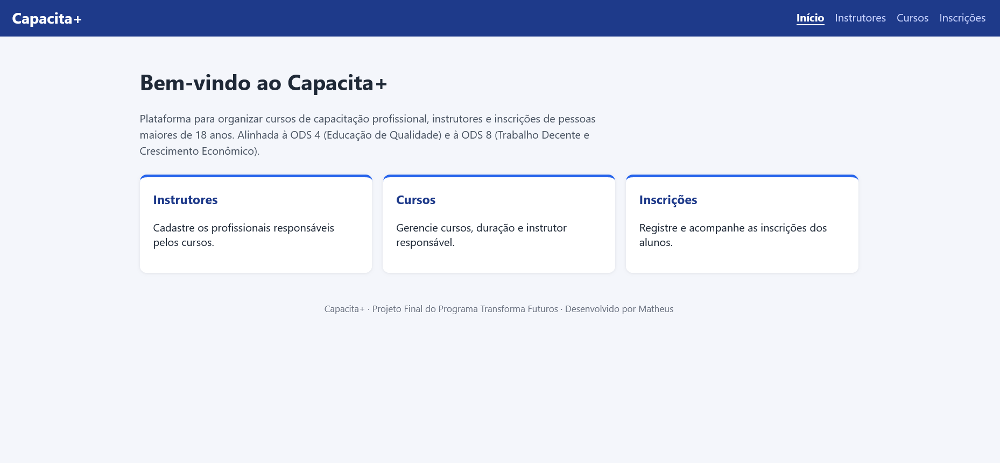

### Instrutores
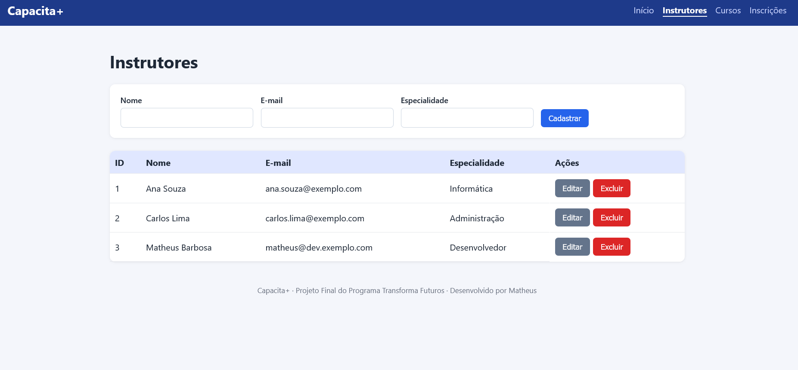

### Cursos
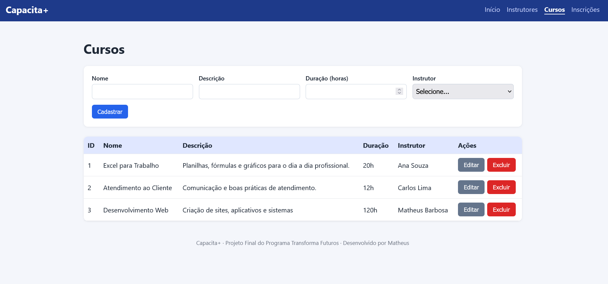

### Inscrições
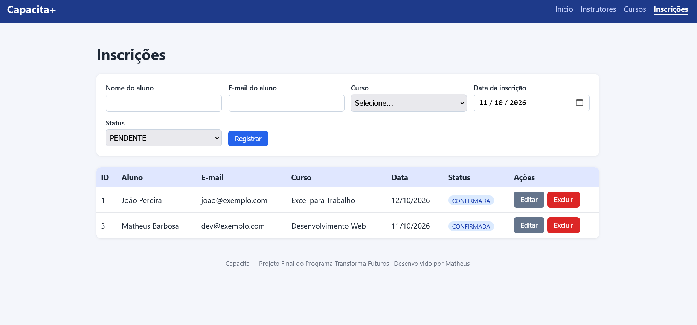

### Dados gravados no MySQL
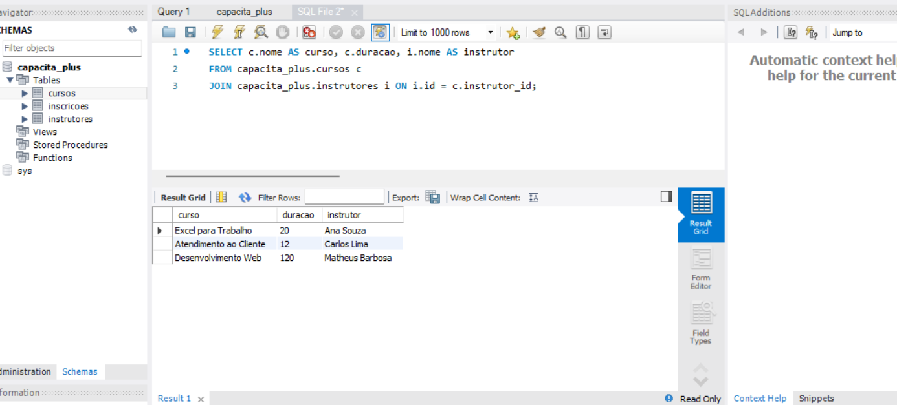

## Autoria

Projeto desenvolvido por **Matheus** ([@Matheus-DEV98](https://github.com/Matheus-DEV98))
como Projeto Final do Programa Transforma Futuros.

### Uso de Inteligência Artificial

Utilizei IA (Claude),chatgpt e gemini como apoio no desenvolvimento, principalmente na geração da estrutura
inicial do código. Minha participação incluiu:

- Planejamento do projeto: ideia, problema, público-alvo, ODS e funcionalidades;
- Modelagem das tabelas do banco de dados;
- Configuração do ambiente (Java, Node.js, MySQL, Git e GitHub);
- Execução, testes e validação dos três CRUDs integrados;
- Personalização da interface e cadastro dos dados de teste;
- Estudo do código gerado para compreender cada parte (banco, API Java e React);
- Documentação e publicação no GitHub.

## Evolução do projeto

Após a avaliação, o projeto recebeu melhorias **apenas estéticas**, sem alterar
nenhuma funcionalidade (backend, banco de dados e CRUDs continuam iguais).

### Versão 1: entrega avaliada
Interface simples com os três CRUDs funcionando (prints na seção "Telas do sistema").

### Versão 2: identidade visual e página inicial
- Logo e cores próprias (azul-marinho e laranja)
- Página inicial explicando o problema, como usar o sistema e as ODS
- Seção "Sobre nós" com foto e QR code para o repositório

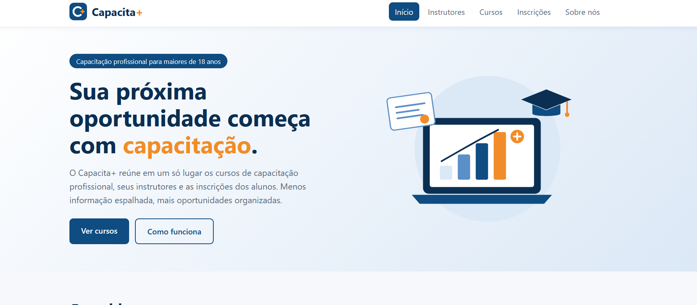
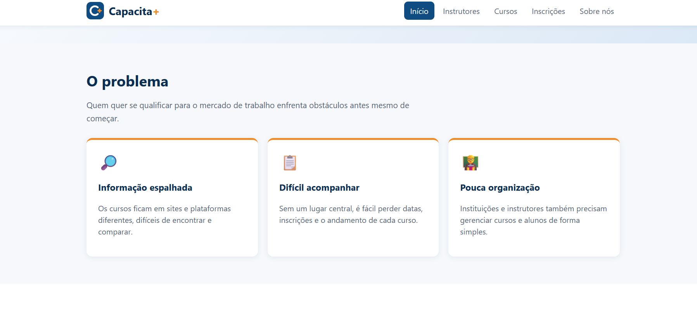
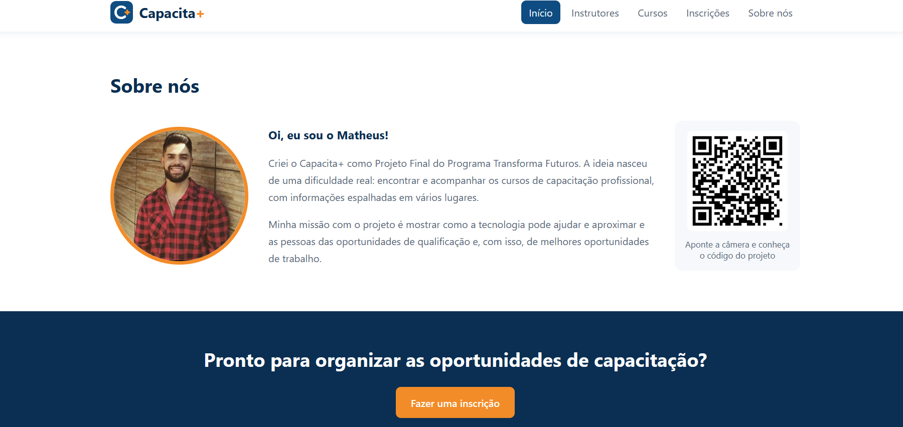
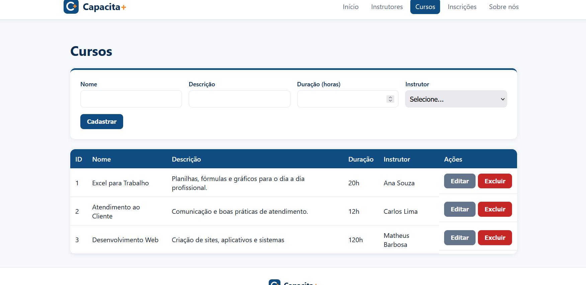

### Versão 3: mais cores e personalidade
- Novas cores verde-água e amarelo-sol, combinando com a identidade
- Cada seção com um fundo claro diferente, reduzindo as áreas brancas
- Desenhos de fundo transparentes com ícones de estudo (livro, capelo, lápis, estrela)

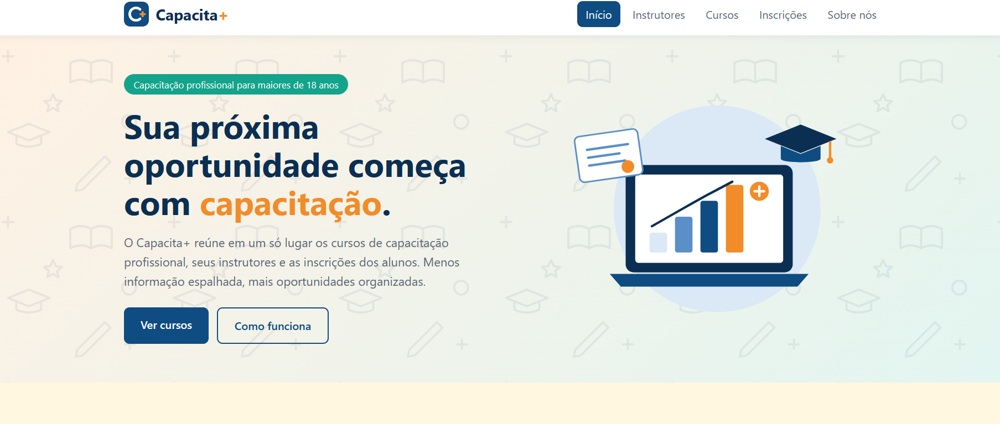
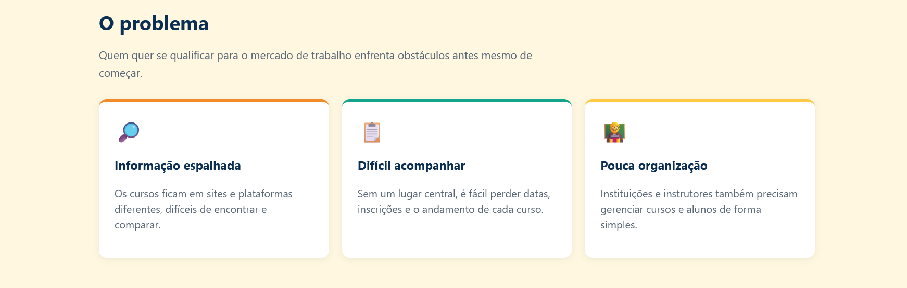
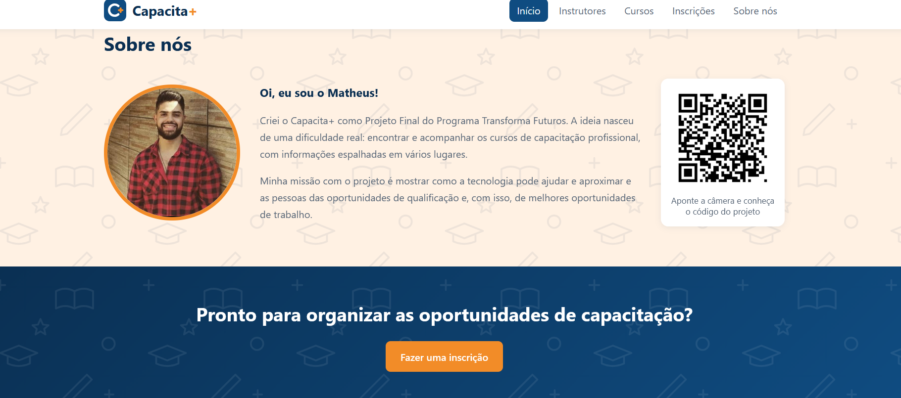
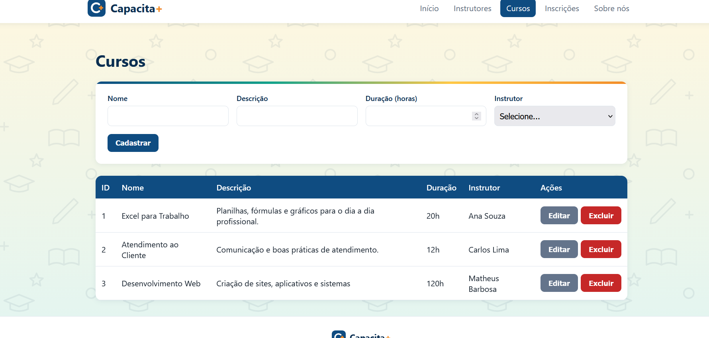